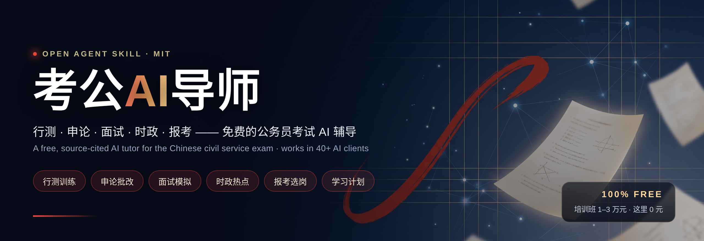

<div align="center">



[](https://github.com/KeWang0622/kaogong-skill/stargazers)
[](LICENSE)
[](https://github.com/KeWang0622/kaogong-skill/actions/workflows/validate.yml)

**免费的公务员与事业单位 AI 备考技能**

`行测` · `申论` · `职测` · `综应` · `公基` · `公文` · `面试` · `时政` · `报考` · `错题复盘`

[开始使用](#开始使用) · [功能](#能帮你做什么) · [使用示例](#直接复制这些话开始) · [内容依据](#内容依据与能力边界) · [贡献](CONTRIBUTING.md)

</div>

## 开始使用

这是给 AI 客户端使用的技能包，包含教学流程与参考资料。项目本身免费开源；所用 AI 平台可能收费。它不是独立题库网站，也不要求注册本站账号。

### 手机 / 网页聊天：先体验

1. 打开 [精简版](dist/kaogong-compact.md)，复制正文到你的 AI 对话中，并说明“请按这些规则辅导我”。
2. 支持文件上传时，再上传 [完整版](dist/kaogong-full.md) 作为参考；仅粘贴精简版不含详细知识库。
3. 发送：“我准备事业单位 A 类考试，先给我一道职测题，等我回答再解析。”

不同平台的上下文、上传和联网能力有差异。粘贴提示词是一种体验方式；复制本地技能目录不会自动安装到手机或网页聊天。支持自定义指令/知识文件的环境可分别使用精简版和完整版，具体入口见 [安装指南](docs/INSTALL.md)。

### Codex / Claude Code 等支持技能的客户端

```bash
git clone https://github.com/KeWang0622/kaogong-skill.git
cd kaogong-skill
./scripts/install.sh
```

脚本询问目标位置。也可指定目录，例如 Codex：

```bash
./scripts/install.sh ~/.agents/skills
```

装好后用自然语言提问；Codex 可显式输入 `$kaogong`。其他客户端的安装路径与触发方式见 [安装指南](docs/INSTALL.md)。同一份技能目录可用于兼容 Agent Skills 的客户端，功能取决于宿主能力；本项目没有逐一验证所有客户端。

### Claude Code 插件：12 个快捷命令

```text
/plugin marketplace add KeWang0622/kaogong-skill
/plugin install kaogong-skill@kaogong
```

下表为本仓库定义的命令名；插件命令在客户端中可能带命名空间，以命令菜单为准。只安装技能目录的用户直接用自然语言即可。

## 能帮你做什么

| 命令 | 模块 | 训练方式 |
|---|---|---|
| `/kaogong` | 入门诊断 | 识别国考、省考、事业单位及目标类别，确定学习入口 |
| `/kaogong-xingce` | 行测 | 政治理论、常识、言语、数量、判断、资料分析 |
| `/kaogong-shenlun` | 申论 | 材料要点分析、应用文与议论文，按训练量表批改 |
| `/kaogong-zhice` | 职测 | 按事业单位类别训练，复用解题方法并核对考纲差异 |
| `/kaogong-zongying` | 综应 | A—E 分类导航，管理、社科、科技、教育及医疗任务 |
| `/kaogong-gongji` | 公基 | 知识讲解、单选/多选/判断及当地大纲要求的材料题 |
| `/kaogong-gongwen` | 公文 | 文种辨析、行文规则、格式改错与材料写作 |
| `/kaogong-mianshi` | 面试 | 结构化单题模拟、反馈与重答 |
| `/kaogong-shizheng` | 时政 | 核对来源、政策联系与考试运用 |
| `/kaogong-baokao` | 报考 | 依据目标公告逐项解读资格、科目与流程 |
| `/kaogong-plan` | 学习计划 | 按每日可用时间安排学习、练习与复盘 |
| `/kaogong-review` | 错题复盘 | 错因、变式练习、复测安排与可复制学习卡 |

**先匹配考试，再训练。** 事业单位不一定考“职测 + 综应”，公基也不是所有岗位的统一第三科。A—E 分类只用于采用相应大纲的招聘；省考 A/B/C 卷不能直接对应事业单位类别。

## 直接复制这些话开始

| 想做什么 | 可以这样说 |
|---|---|
| 了解考什么 | “我是新手，准备考事业编，还不知道职测、综应、公基有什么区别。” |
| 职测 | “我考事业单位 B 类，给我一道论证题，先不要给答案。” |
| 综应 | “给我一道综应 A 类协调处理题，说明身份、材料和字数限制。” |
| 公基 | “出一道公基公文多选题，先说明本次训练的漏选规则。” |
| 公文 | “请示和报告怎么区分？先讲清楚，再给我一道改错题。” |
| 直接批改 | “这是题干、材料和我的作答，请逐条对照材料批改，并说明评分是否属于训练估计。” |
| 复盘 | “整理这次做错和犹豫的题，给我一张下次可以复制回来继续练的学习卡。” |
| 在职备考 | “距离考试 45 天，每天 60 分钟，考公基和写作，帮我安排含复盘的第一周计划。” |

练习默认一次一题、作答后解析；需要直接讲题、参考答案或套题时明确说明。用户已给出的类别、题目和答案会直接使用，不重复入门问卷。

## 内容依据与能力边界

- **官方事实可追溯**：[来源索引](skills/kaogong/references/SOURCES.md)列出文件、年份和适用范围。此次更新核对了 2026 国考大纲、2026 事业单位分类考试大纲、公文条例及格式标准状态。
- **评分区分性质**：公开考纲不等于内部阅卷细则。自拟分值与权重明确标“训练量表，非官方标准”；材料证据、分项分值和合计可检查。
- **题目先自检**：模拟题明确标为原创，要求核验条件、答案、干扰项和计算。出现歧义先修题，不强判考生错误。AI 仍可能出错，欢迎[提交纠错](https://github.com/KeWang0622/kaogong-skill/issues/new?template=content-error.yml)。
- **专业内容有边界**：D/E 类提供分类训练入口与方法，不等同于完整教育或医学专业教材；专业结论需要核实依据。
- **最新信息需核验**：联网时优先查目标考试官方文件；离线时说明未核验，不生成虚假的最新政策或新闻。
- **学习记录由你掌握**：可以导出学习卡，不承诺跨会话永久记忆、自动联网更新或已设置提醒。提交公开 Issue 前请删去个人信息。

本项目与考试主管部门无关，不保证录用或提分，不协助作弊。科目、资格、时间和录用安排以目标考试官方发布为准。

## 项目结构与维护

```text
skills/kaogong/
├── SKILL.md              # 共用规则与模式入口
└── references/
    ├── xingce.md         # 行测
    ├── shenlun.md        # 申论
    ├── zhice.md          # 职测
    ├── zongying.md       # 综应
    ├── gongji.md         # 公基
    ├── gongwen.md        # 公文
    ├── mianshi.md        # 面试
    ├── shizheng.md       # 时政
    ├── baokao.md         # 报考
    ├── review.md         # 错题复盘
    └── SOURCES.md        # 版本与来源
commands/                # 12 个命令，统一进入主技能
scripts/                 # 安装、校验与打包
dist/                   # 自动生成的单文件版本，请勿手改
```

知识按需读取；完整版单文件适用于不能按目录读文件的平台。新增参考文件遗漏打包时构建会失败，避免安装版和网页版内容不同步。

```bash
python3 scripts/validate.py
python3 -m unittest discover -s tests
python3 scripts/build-bundle.py
bash -n scripts/install.sh
```

自动校验覆盖文件与打包完整性，不证明 AI 的实际教学效果。客户端行为验收场景见 [质量检查](docs/QUALITY.md)。

## 欢迎贡献

优先需要：地方考纲适配、带核验记录的原创题、真实使用中的错误案例、D/E 类专业内容审校。制度性事实请附具体出处；原创教学量表请说明设计，不伪称官方。

后续可逐步扩充经过审校的题库、地区与年度适配表，以及经用户同意的匿名反馈统计。当前版本未提供云端账户、学习数据同步或自动题库检索。

[贡献指南](CONTRIBUTING.md) · [更新日志](CHANGELOG.md) · [MIT License](LICENSE)

## In English

**kaogong-skill** is an open-source Agent Skill for Chinese civil service and public institution exam preparation. It covers aptitude tests, writing, structured interviews, public knowledge, official-document exam tasks and study review. Institutional claims cite their scope and sources; generated practice and training rubrics are labeled separately. Use a compatible local skill host or the portable Markdown bundles. Host capabilities and costs vary.
